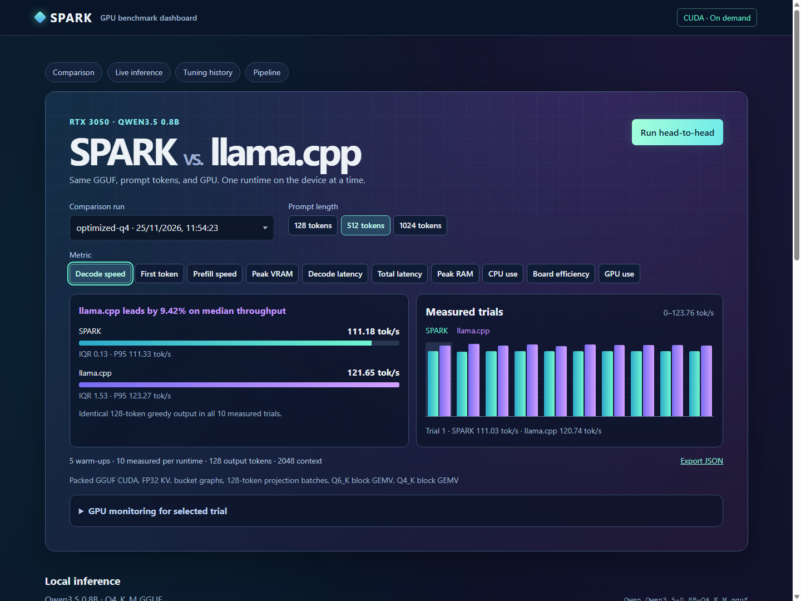

# SPARK

SPARK (Specialized Public Accelerated Runtime for Kernels) targets batch-one
Qwen3.5-0.8B text generation on an NVIDIA GeForce RTX 3050 Laptop GPU. The model
target is the local Q4_K_M GGUF. SPARK reads the file in native C++20.

SPARK runs native text generation on CPU and CUDA from this GGUF. A local
FastAPI dashboard streams responses from the CUDA worker and compares saved
native benchmark runs. SPARK uses llama.cpp as an external benchmark process.
The native runtime implements its own GGUF loader, byte BPE, recurrent
Gated DeltaNet, grouped-query attention and packed CUDA projections.

## Requirements

Use a C++20 compiler, CUDA Toolkit 12.x or later, an NVIDIA Ampere GPU
with a compatible driver, and a local Qwen3.5-0.8B text GGUF. The Windows
verification used MinGW GCC, CUDA Toolkit 12.8, and a 6 GiB RTX 3050 Laptop
GPU. The CPU path needs room for the expanded FP32 weights. Node.js is
used for the comparisons and browser captures. Python and the API
requirements are needed for the local dashboard.

## Build and inspect

```powershell
powershell -File scripts/build_cpu.ps1
& build/cpu/spark.exe inspect --model 'PATH\TO\Qwen_Qwen3.5-0.8B-Q4_K_M.gguf'
& build/cpu/spark.exe tokenize --model 'PATH\TO\Qwen_Qwen3.5-0.8B-Q4_K_M.gguf' --prompt 'What is 2 + 2?'
$env:OMP_NUM_THREADS = '6'
& build/cpu/spark.exe generate --model 'PATH\TO\Qwen_Qwen3.5-0.8B-Q4_K_M.gguf' --prompt 'What is 2 + 2? Answer with just the digit.' --chat --max-new-tokens 16
& build/cpu/spark.exe generate --model 'PATH\TO\Qwen_Qwen3.5-0.8B-Q4_K_M.gguf' --prompt 'What is 2 + 2? Answer with just the digit.' --chat --max-new-tokens 16 --device cuda --cuda-weights packed --batch-prefill --cuda-graph bucket --q4-block-gemv --q6-block-gemv
```

Add `--tensors` to list each tensor's shape, format, byte offset, and size.
The inspector also decodes the first embedding row to verify weight access.
The tokenizer reads the vocabulary and merges directly from the GGUF.
With CMake, run `cmake --preset release` and `cmake --build --preset release`.
Use the executable under `build/release` or `build/release/Release`.
Run `ctest --preset release` or `build/cpu/spark_packed_weights_test.exe` to
check packed weight decoding. The fallback build also creates the sampler,
DeltaNet, and CUDA operation test executables.

Generation defaults to greedy sampling and a context of 2,048 tokens.
`--chat` selects the single-turn Qwen prompt format with thinking disabled.
`--temperature`, `--top-p`, and `--seed` configure sampling. The CPU
implementation expands approximately 3 GB of FP32 weights in host RAM.
The FP32 CUDA reference expands the same weights into a device arena. The
packed path keeps mixed Q4_K, Q5_K, Q6_K, Q8_0 and F32 tensors in their GGUF
storage. Prompt projections share 128-token chunks while preserving
causal state. Decode uses specialized packed GEMV and supports bucketed
CUDA Graph replay. The runtime uses
NVRTC and cuBLAS from the local CUDA toolkit. The Windows build uses the
toolkit pointed to by `CUDA_PATH`. Pass `--profile` on a CUDA request to
record GPU stage timings for the first decode step after prefill.

## Reproduce CPU correctness checks

Run the check against the same weights dequantized to FP32 by the external
reference. Use the b10159 Windows comparison binaries and Node.js. Omit
`-Full` for the three-prompt smoke test. The full test evaluates 20 prompts
and 64 greedy tokens per prompt. Both runtimes use FP32 key and value caches
for this CPU correctness comparison.

```powershell
powershell -File scripts\verify_qwen_cpu.ps1 -Model 'PATH\TO\Qwen.gguf' -ReferenceBin 'PATH\TO\llama-b10159-bin-win-cuda-13.3-x64' -Full
```

Results are written under `build/qwen-reference`. The CPU model and tests
use the original GGUF. The expanded comparison GGUF is a local build artifact.

## Run the dashboard locally

Build SPARK with CUDA enabled. Install the API requirements in a Python
environment and pass its interpreter with `-Python` if needed.

```powershell
python -m pip install -r api\requirements.txt
powershell -File scripts\run_dashboard.ps1 -Model 'PATH\TO\Qwen.gguf'
```

Open the loopback address printed by Uvicorn, normally
`http://127.0.0.1:8765/`. **Generate** starts the native CUDA worker on
demand with packed GGUF weights. **Compare** loads stored trial results and can queue another native
benchmark. The service serializes generation and benchmarks on the GPU.
Compare historical runs, inspect paired board utilization and VRAM
timelines, export trial JSON, or delete dashboard-created comparison runs.
The live worker uses the configured Qwen file.
**Run head-to-head** benchmarks SPARK and the CUDA llama.cpp server on the
same model and GPU. Use the comparison section to switch prompt length and
metric or select an individual trial. The API defaults to the repaired
`build/llama-b10159-cuda13/llama-server.exe`. Set `SPARK_LLAMA_SERVER` to
override its path.

Run the same harness directly from the repository:

```powershell
node benchmark/comparison/compare_cuda.cjs build/cpu/spark.exe build/llama-b10159-cuda13/llama-server.exe 'PATH\TO\Qwen.gguf' build/spark-vs-llama-cuda.json --batch-prefill --bucket-graph --q4-block-gemv --q6-block-gemv
```

## Measured performance

Same Qwen3.5-0.8B Q4_K_M artifact, 512 prompt tokens, 128 greedy outputs,
and one RTX 3050 Laptop GPU. Five warm-ups and ten measured trials per
runtime. Values are medians.

| Runtime | First token | Prefill | Decode | Peak VRAM |
| --- | ---: | ---: | ---: | ---: |
| SPARK serial CUDA | 6,969 ms | 73.48 tok/s | 50.29 tok/s | 683 MiB |
| SPARK tuned CUDA | 839 ms | 611.92 tok/s | 111.18 tok/s | 753 MiB |
| llama.cpp b10159 CUDA | 144 ms | 3,618.39 tok/s | 121.65 tok/s | 761 MiB |

SPARK matched every generated token across the full comparison and
independent repeat. llama.cpp led the latency and throughput metrics.
At 128 input tokens, SPARK reached 117.77 tok/s versus 124.65 tok/s.
[Raw results and quality checks](docs/RESULTS.md)



## Evidence

- [Architecture and tensor layout](docs/ARCHITECTURE.md)
- [Reproducible benchmark protocol and telemetry definitions](docs/BENCHMARKING.md)
- [Benchmark results and correctness gates](docs/RESULTS.md)
- [Optimization history and rejected experiments](benchmarks/optimization_log.md)
- [Dashboard screenshots](docs/showcase/README.md)
- [Known limitations](docs/LIMITATIONS.md)
