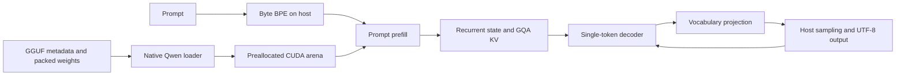

# Architecture

SPARK is a native C++20 Qwen3.5 text inference runtime. The CUDA backend
loads GGUF weights directly and uses NVRTC for the CUDA kernels. cuBLAS is
used for dense FP32 projections. During prefill, projection weights are
expanded into one scratch matrix and reused across up to 128 prompt
positions. DeltaNet and attention consume those projections in causal
order. Decode specializes Q4_K and Q6_K projections by block format,
sharing packed bytes across the lane's products. Bucketed graph replay
reduces the CPU launch cost. The backend selects CUDA explicitly and
surfaces initialization and capacity failures.

The active decoder contains 24 layers, including 18 Gated DeltaNet blocks
and six grouped-query attention blocks. Each layer also applies a SwiGLU
MLP. Recurrent state, convolution history, and each attention cache stay
resident. The final projection uses the tied embedding matrix. The
interactive path runs on one explicit stream and synchronizes at the
sampling boundary.

The packed CUDA path uses the artifact's mixed Q4_K, Q5_K, Q6_K, Q8_0
and F32 tensors. The CPU reference path expands the weights to FP32 and
implements the same sequence operations independently. FastAPI streams
native worker output and serializes CUDA benchmarks to avoid GPU contention.
The comparison harness starts llama.cpp as a separate process.

[Architecture audit](ARCHITECTURE_AUDIT.md) |
[Tensor layouts and dimensions](DESIGN.md) |
[Benchmark boundaries](BENCHMARKING.md)
